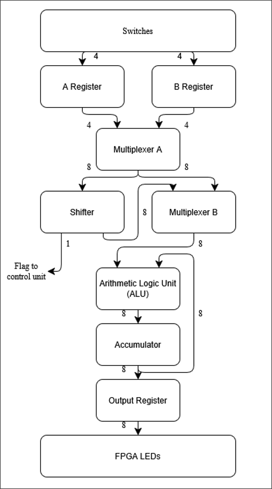
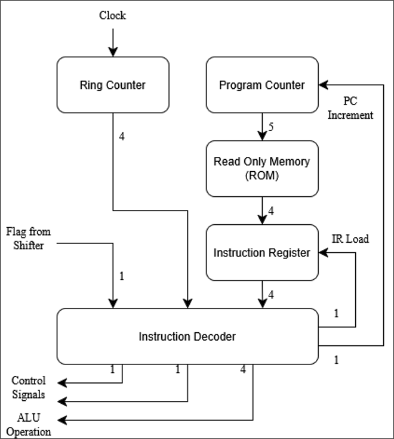
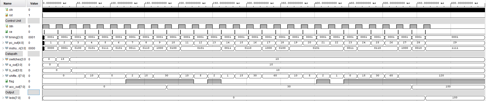
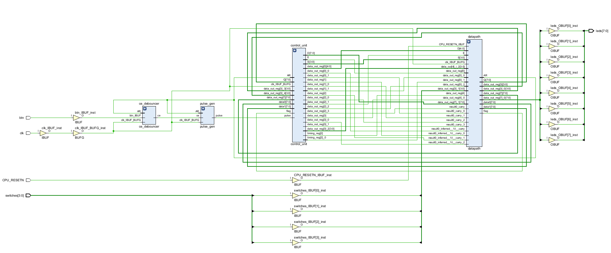

# 4-bit Microprocessor on FPGA

A minimal-area 4-bit microprocessor designed in Verilog and implemented on a Xilinx FPGA, built as my 2nd-year Design Project at the University of Sheffield (Electrical and Electronic Engineering).

> **Status:** Complete (coursework project). Two-person project; I completed the design, testbenches and FPGA implementation.

## Overview
The brief was to design a processor for a fixed 16-instruction ISA with **minimum gate count** (execution speed did not matter), prove it in simulation, and demonstrate it on an FPGA development board. The processor is validated by running a shift-and-add program that multiplies two 4-bit numbers, plus a program of my own choosing.

## Architecture
- **Datapath:** A and B registers, a shifter (load, shift left/right, flag output), an ALU (add, subtract, invert, AND, OR, XOR), an accumulator and an output register.
- **Control:** Hardwired combinational control unit (`control_unit`, `instruction_decoder`). A 4-phase one-hot ring counter (T0 fetch, T1 decode, T2 execute, T3 PC update) is combined with the decoded 4-bit opcode to generate register enables, shifter control, ALU operation select and mux selects. The conditional-accumulate instructions (`ACC NZ`) also depend on the shifter flag.
- **Memory:** 32 × 4-bit program ROM (`ROM.v`), addressed by a 5-bit program counter.
- **Clocking:** Single synchronous clock with enable-controlled registers. A debounced push-button (`ce_debouncer`) triggers `pulse_gen`, which advances the ring counter through four clock cycles, so **one button press executes one full fetch-decode-execute cycle**. This lets the program be stepped through by hand on the board.

### Modules (`rtl/`)
| File | Role |
|---|---|
| `microprocessor_top.v` | Top level: connects control, datapath, PC and ROM |
| `control_unit.v`, `instruction_decoder.v`, `ring_counter.v` | Instruction timing and control-signal generation |
| `datapath.v` | Registers, shifter, ALU, accumulator and muxes |
| `alu.v`, `shifter.v`, `accumulator.v`, `mux_2to1.v` | Datapath blocks |
| `register_4bit.v`, `output_register.v`, `program_counter.v` | Registers |
| `ROM.v` | Program memory |
| `ce_debouncer.v`, `pulse_gen.v` | Input conditioning for the board's buttons |

| Datapath | Control |
|---|---|
|  |  |

## Instruction set
| Group | Instructions |
|---|---|
| Load | `LD A`, `LD B`, `LD O` (from input switches / to output register) |
| Shifter | `LD SH A`, `LD SH B`, `SHR`, `SHL` |
| Accumulate | `ACC NZ A`, `ACC NZ SH`, `CLR ACC` |
| ALU | `ADD`, `SUB`, `INV`, `AND`, `OR`, `XOR` |

Opcodes:

| Opcode | Mnemonic | Opcode | Mnemonic |
|---|---|---|---|
| `0000` | LD A | `1000` | ACC NZ SH |
| `0001` | LD B | `1001` | ADD |
| `0010` | LD O | `1010` | SUB |
| `0011` | LD SH A | `1011` | INV |
| `0100` | LD SH B | `1100` | AND |
| `0101` | SHR | `1101` | OR |
| `0110` | SHL | `1110` | XOR |
| `0111` | ACC NZ A | `1111` | CLR ACC |


Multiplication is not a single instruction: it is performed by a shift-and-add program using the shifter and conditional-accumulate instructions.

## Repository layout
```
rtl/           Verilog source (top level: microprocessor_top.v)
tb/            Testbenches
constraints/   Nexys 4 DDR pin constraints (.xdc)
docs/          Block diagrams, waveform, synthesis schematic
```

## Simulation
Tools: Xilinx Vivado. [Say how to run: e.g. open `tb/<top_tb>.v` as the simulation top and run behavioural simulation.]



The testbench enters 15 and 10 on the switches and steps through the shift-and-add program. The accumulator builds up the partial sums (30, then 150) and the output register drives the LEDs with 150 (15 × 10).

## Hardware demonstration
Implemented on a Digilent Nexys 4 DDR (Xilinx Artix-7) using the 4 on-board switches for input. The 8-bit result is shown in binary on the 8 on-board LEDs, and a push-button steps the program one instruction at a time.

Synthesised schematic:


## What I learned
Building this processor taught me how a digital system divides into a datapath and a hardwired control unit. I wrote the instruction decoder myself, turning a 4-bit opcode and a one-hot timing signal into the enables and ALU controls for each phase of the instruction cycle. Designing around a single synchronous clock with enable-controlled registers, and testing each block before integrating, made debugging much faster.

Testing exposed a bug where larger operands lost their upper bits when shifted left, giving wrong products. Tracing the waveform showed the shifter was truncating the result, so I widened the shifter path to 8 bits. It taught me to test corner cases such as 15 × 15 as well as small numbers.
